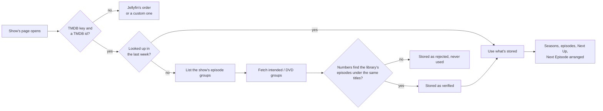

# Episode Orders

## What it does
Some shows aired out of order. Steven Universe is the usual example: "Open Book", "Shirt Club",
"Story for Steven" and "Say Uncle" were made for season 1 but aired during season 2. Sharkfin can
show, browse and play a show in another order:
- in its own seasons, or across seasons;
- automatically, from a documented order (a creator's intended order, else the DVD order);
- or arranged by hand.

Nothing on the server changes: no files are renamed or moved, Jellyfin's metadata isn't edited,
and every episode keeps its own Jellyfin id. So the right video always plays, and progress, watched
marks and resume points stay attached to the episode whatever its place.

| Order | Where it comes from | Used |
|---|---|---|
| **Jellyfin's order** | The server's numbering | When nothing else applies, or chosen |
| **Intended order** | A TMDB episode group whose name says "Intended" | Automatically (first choice) |
| **DVD order** | A TMDB episode group of type DVD | Automatically (when there's no intended order) |
| **Production, absolute, digital, story arc, TV** | Other TMDB episode groups | Only when chosen on the show's Episode Order screen |
| **Custom** | Arranged by hand | When saved |

The production order is never used on its own, and is never assumed to be the intended order.
Release dates are never used to reorder anything.

## Steven Universe, checked against the sources
| Episode | Aired order (TheTVDB, TMDB) | DVD / absolute order (TheTVDB) |
|---|---|---|
| Open Book | S02E02 | S01E46 |
| Shirt Club | S02E06 | S01E47 |
| Story for Steven | S02E05 | S01E48 |
| Say Uncle | S02E04 | S01E53 |

Wikipedia's episode list follows the "intended order" given by co-executive producer Ian
Jones-Quartey, which also puts them in season 1. TVmaze numbers them differently again (Open Book
1x51, Say Uncle 2x01): sources disagree, which is why an order is only used after it has been
checked against the library (below). Whether TMDB has a DVD or intended group for Steven Universe
wasn't checked (TMDB's site couldn't be reached from the build environment).

## How it works

### Where orders come from
- **TMDB episode groups:** `GET /3/tv/{id}/episode_groups`, then `GET /3/tv/episode_group/{id}`.
  This needs the viewer's free TMDB key, under **Settings → Ratings**. Either a v3 API key or a v4
  read access token works.
- **Where the key is kept:** like the MDBList and Trakt keys, in the secure vault and the user's
  Jellyfin profile.
- **Who asks TMDB:** the TV itself, not the server. So it works when the server is offline from the
  internet, and the server's own metadata settings are never touched.
- **How often:** a show's list is fetched at most once a week, in the background after its page has
  appeared. A group is fetched once.
- **Offline backup:** everything found is stored on the device (`episode-order-<server>.json`). If
  TMDB or the internet is down, the last verified order stays in use. Hand-made orders never need
  the internet.

### Checking an order against the library (`EpisodeOrders.verify`)
- An order lists episodes by their aired season and number, the numbering Jellyfin uses when the
  show is in its default order.
- At least 90% of the library's regular episodes must be found by those numbers.
- The episodes found must also carry the same titles (80% or more). The title is a check that both
  use the same numbering, not the way episodes are matched.
- An order that fails is kept as "rejected" with the reason and is never applied, even if chosen.

### Arranging (`EpisodeOrders.arrange`)
- The show's episodes are fetched in one request, with its seasons alongside. Split files are
  already shown as their episodes at this point, so [[Virtual Episode Splitting]] works inside
  orders.
- **Placement:**
  - A source order places episodes by their aired numbers; a custom order by item id.
  - An episode the order doesn't mention (one added later, say) stays next to the episode before it
    on the server, in its own season.
  - A season the server has keeps its id and pictures. A season only the order has gets an id like
    `vsn~<series>~<n>` and the show's pictures.
- **Numbers shown:** episodes are renumbered by their place in the arranged season (Open Book shows
  as S1 E4 in the example above). Ids, files and progress don't change.
- **Cards elsewhere:** Continue Watching, Latest and the player's title use the last arranged
  numbers (`relabel`).
- **Specials** left in season 0 stay at the end.

### Where the order is used
| Place | How |
|---|---|
| Season tabs and episode rows | `seasons()` / `episodes(seasonId)` return the arranged seasons and episodes |
| Next Episode and autoplay | The episode after the playing one in the arranged list, across seasons. Episodes the server only lists (not on disk) are skipped |
| Next Up (a show's Play, Home's row) | After the episode watched most recently, the first unwatched one in the order. Home leaves an episode already started to Continue Watching |
| Player's episode menu | Same seasons and lists as the details page |
| Continue Watching | Unchanged (it's by progress); cards show the arranged numbers |

Jellyfin's own Next Up follows its numbering (and the highest-numbered episode watched), so for a
show in another order Sharkfin works it out itself from the show's episodes.

## Choosing or arranging an order
On a show's page, **Episode Order** (it shows the current one, for example "DVD Order") opens the
editor:
- **Automatic, Jellyfin's order, each TMDB order, Custom.** Choosing a TMDB order fetches it and
  checks it first. One that doesn't fit is explained and isn't applied.
- **Custom** starts from the order shown now, so a DVD order can be adjusted by hand.
- **Moving an episode with the remote:**
  1. Select the episode to pick it up.
  2. **Up/Down** moves it one place. At a season's edge it moves into the next season.
  3. **Left/Right** moves it to the end of the previous season or the start of the next one.
  4. Select again to put it down, or press **Back** to undo the move.
- **Position in its season:** type a number, then press **Move There**.
- **New Season** adds an empty season to move episodes into.
- **Save** keeps the order. **Reset to Jellyfin's Order** goes back to the server's own.
- **Look Up Orders Again** refreshes the list from TMDB before the week is up.

Orders are kept per server and shared by its profiles, because they describe the show, not anyone's
viewing. **Settings → Behaviour → Automatic episode order** turns automatic orders off everywhere.

## The Home banner (the "random episodes" Gumball problem)
The banner featured a show by its newest episode, and its **Play** started that newest episode.
- For a show still being watched, that was a random later episode.
- Jellyfin then marked it watched, and Jellyfin's Next Up follows the highest-numbered episode
  watched, so the show's Next Up jumped past everything before it.

Now a show on the banner plays what its own page's Play would (the episode in progress or next, in
the show's order, else its first episode), and **More Info** opens the show. See
[[Fixed Issues]].

## Performance
- **Shows in Jellyfin's order (most shows):** nothing changes, with no extra requests and no extra
  work.
- **A show in another order:** one request for all its episodes instead of one per season. It's
  shared for a minute by the season tabs, each season, Next Up and the player's menu, and dropped
  when something is watched.
- **TMDB:** asked in the background after the page is up, at most weekly per show. It never delays
  the page.
- **Measured in CI (Zephyr Bay sample, 6 episodes):** see the integration report line "Episode order
  (Zephyr Bay)" for the plain and arranged list times.

## Limitations
- **TMDB key:** automatic orders need one, and the library must use TMDB's or the same aired
  numbering. A library numbered another way (TheTVDB's DVD numbering, say) fails the check, and
  stays in Jellyfin's order unless arranged by hand.
- **Live TMDB not tested:** in CI the TMDB answers are simulated (in the documented format). No real
  TMDB request has been made, because CI has no key.
- **Server Next Up:** for an account profile, Home's Next Up only lists shows the server already
  puts in Next Up (each then gets Sharkfin's own next episode). A show that the server's numbering
  says is finished can be missing from the row while episodes earlier in its order are unwatched;
  its page's Play still gets it right.
- **Upcoming episodes:** air dates on a show in another order are still matched by the server's
  season numbers.
- **Detail-page timing:** a show whose automatic order is found the first time its page opens
  reloads its episode list once when the order arrives.

## Code
- `jellyfin/EpisodeOrder.kt`: `OrderStore`, `SeriesOrder`, `OrderPlan`, `EpisodeOrders` (`plan`,
  `arrange`, `nextUp`, `relabel`, `verify`, `candidates`).
- `jellyfin/TmdbEpisodeGroups.kt`: TMDB episode groups (key never logged; timeouts of 8 s).
- `jellyfin/JellyfinApi.kt`: `order`, `orderSource`, `arrangement`, `seasons`, `episodes`, `nextUp`,
  `seriesPlayTarget`, `lookUpOrders`, `sourceOrder`, `setOrder`, `displayed`.
- `ui/screens/EpisodeOrderEditor.kt`: the editor. `Detail.kt`: Episode Order button and background
  lookup. `Home.kt`: banner Play / More Info.
- **Tests:** `commonTest/EpisodeOrderTest.kt`, `jvmTest/JellyfinIntegrationTest.orderCheck`, and
  the emulator check "Episode moved across seasons by remote" in `ci/android_e2e.sh`.

Related: [[Episode Browser]], [[Video Player]], [[Watch History]], [[Virtual Episode Splitting]].
