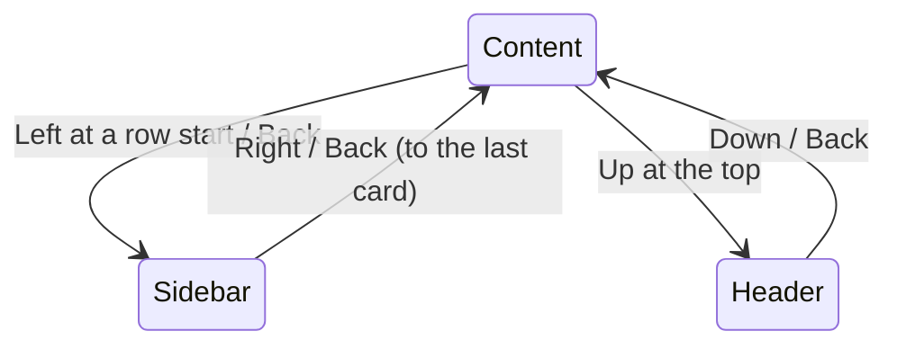

# Navigation System

## What it does
Moving around the app with a TV remote, keyboard, game controller or mouse: the sidebar, the
profile button, screens, rows and the back stack.

## How it works
- **Back stack** (`Navigator`): each entry keeps its screen model (data, scroll state) and a
  `FocusMemory`, so Back returns to the exact card.
- **Sidebar sections:** Home, Movies, TV Shows, Continue Watching, Favorites, Search, Libraries,
  Settings.
- **Regions** (`FocusRegions`): sidebar, content and header (profile button) have explicit rules
  instead of Compose's geometric search. See [[Focus Management]].
- Keyboards: arrow keys work like the D-pad (Android moves focus itself; `arrowKeyNavigation()` does it on the JVM test host).

## Relevant files
`ui/nav/Navigator.kt`, `ui/nav/FocusRegions.kt`, `ui/components/Focus.kt`, `ui/App.kt`
(MainShell, SideBar).

## Dependencies
[[Focus Management]] · [[UI Sounds]]

## Data storage
None (in memory per back-stack entry).

## Performance considerations
Focus scale changes go through `graphicsLayer`, so focus never causes relayout.

## User interactions
D-pad / arrows, OK/Enter, Back/Escape; mouse hover focuses.

## Known limitations
See [[Navigation Bugs]].

## Related notes
[[Navigation Behavior]] · [[Focus Management]]
