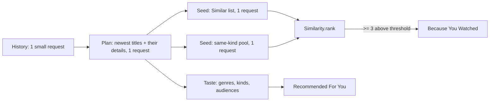

# Recommendations

## What it does
Home rows **"Because You Watched <title>"** and **"Recommended For You"**, personal to each profile.
A title appears only with a clear reason; a row with fewer than 3 close matches is left out rather
than padded with unrelated titles.

## The problem this update fixed
"Because You Watched *Charlotte*" (an anime) showed *The Inbetweeners* and *Adventure Time*. The old
ranking took Jellyfin's Similar list and kept anything sharing **one** genre with the seed, and added
the other kind (films for a show) by genre overlap. Charlotte's genres (Animation, Comedy, Drama,
Sci-Fi & Fantasy) share "Comedy" with a British sitcom and "Animation"/"Comedy" with a kids' cartoon.

## How it works now

1. **Plan** (`RecommendationService.plan`): recently finished titles (one request), then the newest
   8 titles' details — genres, tags, description, origin, original title, studios, age rating,
   provider ids — in one `ids=` request.
2. **Content kind** (`playback/ContentKind.kt`): Anime (anime database id, "Anime" genre/tag, or
   animated *and* Japanese: made in Japan, Japanese original title, Japanese audio), other
   Animation, or Live action.
3. **Candidates per seed**: Jellyfin's Similar list (it also weighs cast, crew and studios) plus
   unwatched titles of the same kind (anime → the Anime/Animation genres; live action → the seed's
   own content genres), up to 60, with the comparison fields.
4. **Score** (`recommend/Similarity.kt`):

| Part | Weight | Notes |
|---|---|---|
| Genre overlap | 0.45 (0.55 without tags) | weighted Jaccard; rare genres count more (IDF over the candidates); Animation/Anime excluded (the kind covers them) |
| Tag/keyword overlap | 0.2 | only when both have tags |
| Description similarity | 0.35 (0.45 without tags) | TF-IDF cosine of distinctive words (stop words removed, plurals folded), doubled and capped at 1 |
| Bonuses | +0.06 each | in Jellyfin's Similar list; a studio in common |
| × Kind factor | 1 / 0.35 / 0.3 / 0.2 | same kind / anime↔animation / animation↔live / anime↔live |
| × Audience factor | 0.5 or 0.8 | children's ↔ teen/adult 0.5; family ↔ adult 0.8 (from the age rating, else Kids/Family genres) |
| + Rating | 0.005 × community rating | a tie-break only (at most +0.05) |

   A candidate needs a **reason** (genre overlap ≥ 0.25, tag overlap ≥ 0.2 or description ≥ 0.15)
   and a score ≥ **0.25**. Watched, in-progress and already-shown titles are excluded; each title
   appears in one row only.
5. **Recommended For You** (`RecommendationEngine.taste` / `rankForTaste`): genre profile from the
   history (newer, favourites, thumbs-up and own ratings count more; thumbs-down counts against),
   multiplied by the share of the profile's viewing in the candidate's kind (0.2 + 0.8 × share) and
   halved for children's titles when the profile doesn't watch them. Kept when ≥ 0.15 with a genre
   match ≥ 0.2.

### Worked example (unit test `becauseYouWatchedAnAnimeMeansAnimeWithSimilarStories`)
| Candidate | Kind | Score | Shown |
|---|---|---|---|
| Angel Beats! (anime; school, special abilities, drama) | same | 0.79 | ✅ |
| Erased (anime; an ability, school days, mystery drama) | same | 0.33 | ✅ |
| a ramen-shop anime (only "Comedy" in common) | same | 0.21 | ❌ no clear reason |
| Adventure Time (Western cartoon) | ×0.35 | 0.12 | ❌ |
| The Inbetweeners (live-action sitcom) | ×0.2 | 0.08 | ❌ |

## New profiles, failures and "not loading" (Nov 2026, second pass)
**What was wrong** (investigated from the code; the user's report was "Recommended doesn't load"):
- **A new profile got no recommendation rows at all.** The rows were only offered when the history
  had a title to base them on ("Because You Watched") and "Recommended For You" needed two watched
  titles. With nothing watched, nothing was even attempted.
- **A failed request was saved as the answer.** Each request inside the computation swallowed its
  own error and returned nothing, so a busy or unreachable server produced fewer or no rows, which
  were then saved under the history's signature and reused on every launch until something new was
  watched ("History unchanged: 0 saved row(s), no requests").
- **Placeholders that didn't resolve broke navigation.** The three recommendation rows are placed
  from the history straight away and show a placeholder until worked out; rows that came back empty
  stayed in Home's list at zero height. Together with Top 10 these formed a gap that Up couldn't
  cross (see [[Fixed Issues]] → Home navigation).
- **Slow:** the requests ran one after another (per seed: Similar, then the pool; then the
  For You candidates).

**Now:**
- **"Recommended For You" is offered to every profile.** A profile that has watched one title or
  none (`COLD`):
  1. **Favourites first.** Its favourites (one small request, made only for such a profile) give a
     taste profile like a history would; titles in those genres are ranked the same way
     (`rankForTaste`). A favourite is never suggested back, and children's titles are left out when
     its taste has none.
  2. **Otherwise the library's best.** The best-rated unwatched films and shows (one request, up to
     60), taking turns across genres so the row isn't all one genre (`RecommendationEngine.highlights`).
     With a favourite or watched title, only the kinds of content those are (anime, animation, live action).
  - A profile with a real history only gets titles that fit it: no padding with popular titles.
- **Failures aren't saved.** Each request reports whether it worked. If any failed, the rows that
  did work out are shown but not saved, and they're worked out again after a minute (`RETRY_MS`)
  the next time Home asks. If the whole computation fails, "Recommended For You" shows
  *Couldn't load this row · Try again* after three attempts instead of a placeholder; the
  "Because You Watched" rows just stay out of the way.
- **No endless placeholder.** Every Home row's attempt gives up after 30 s
  (`RAIL_ATTEMPT_TIMEOUT_MS`), three attempts in all, then shows Try again.
- **All requests at once.** Similar lists, pools and the For You candidates are sent together;
  the ranking afterwards is still in order (a title appears in one row only).
- `ALGORITHM` is now `v3`, so rows saved by the old code (including empty ones) are worked out once more.

**Requests:** unchanged for a profile with a history (per seed: Similar + one pool; one for For
You), now concurrent. A new profile: history, favourites, and one or two item lists.

**Tests:** `RecommendationColdStartTest` (new profile → library's best across genres; favourites
steer it; a failed request is not saved). The real-server integration test still checks that each
profile gets its own taste and never another's.

## Kept in memory per profile (Nov 2026)
**The bug:** "Recommended For You" reloaded every time Home was opened again. Choosing Home in the
side menu builds a new Home screen (`Navigator.selectSection` starts a new back-stack entry), so each
visit started from nothing:
- the saved copy was read from disk;
- the history was asked for again (two requests);
- the recommendation rows waited for it (up to 600 ms) and were otherwise merged in late, which is
  the visible reload.

**Now** (`RecommendationService.planFor` / `peekPlan`, `HomeSnapshot`):
- **Per-profile plan in memory.** The history plan (ids, weights, likes, genres, and the signature
  that identifies the ranking) is kept per profile. It's *fresh* while no title has been watched,
  marked played or favourited on this device (`WatchActivity`) and for 30 minutes (to notice
  activity on other devices). A fresh plan costs no request.
- **Stale-while-revalidate.** An old plan still places the rows at once; a new one loads in the
  background and replaces the rows in place only if the history signature (or the seed titles)
  changed.
- **Deduplicated.** Homes asking at the same time share one load (`planLoads`).
- **Rows recomputed only when the history or likes change** (the signature includes the weights,
  which carry thumbs up/down). They're kept as ranked lists of card-only records (`slim`: no tags,
  cast, descriptions beyond 240 characters, media or chapter data), in memory and in
  `recommendations-<profile>.json`.
- **Home itself is remembered** for the session (`AppContainer.homeMemory`, the last two profiles):
  Home opened again shows the same rows, banner and brand tiles at once, and asks the server
  nothing for 5 minutes after its last load. Watching something still refreshes Continue Watching,
  Next Up and the recommendations (the `WatchActivity` effect).

**Measured** (CI emulator, release build; Home → Movies → Home three times, `Perf: Home opened again`;
two CI runs each):

| | Before | After |
|---|---|---|
| Rows on screen after reopening Home | 81 / 127 / 51 ms; 144 / 75 / 82 ms | 6 / 5 / 6 ms; 8 / 13 / 5 ms |
| API requests in its first 10 s | 10 / 13 / 10; 14 / 10 / – | 0 / 0 / 2; 0 / 0 / 3 |

The 2–3 requests on some visits are most likely the Movies screen's own requests finishing after the
switch (the counter is app-wide); not confirmed.

Unit test: `RecommendationCacheTest` (memory hit, one load for simultaneous callers, new load after
watch activity, per-profile, forgotten on profile removal).

## Relevant files
`recommend/Recommendations.kt` (RecommendationEngine, RecommendationService), `recommend/Similarity.kt`,
`playback/ContentKind.kt`, `ui/screens/Home.kt` (recommendationRails, HomeSnapshot), `ui/AppContainer.kt`
(homeMemory), `data/WatchActivity.kt`, `jellyfin/JellyfinApi.kt`
(`Fields.SIMILARITY`, `similar(fields)`).

## Dependencies
[[Watch History]] · [[Home Page]] · [[API Endpoints]] · [[User Profiles]]

## Data storage
`recommendations-<profile>.json`: the finished rows and a **signature** of the history (plus the
algorithm version, so the new ranking recomputes once). While the history is unchanged, a launch
costs only the history request.

## Performance considerations
Same request count as before (per seed: Similar + one pool; plus two plan requests), slightly larger
responses (tags, description). Scoring ~80 candidates is a few milliseconds on the device; nothing
runs on the server beyond ordinary item queries. No model, no catalogue download, no outside service.

## Known limitations
- Quality depends on the library's metadata: with no descriptions or tags, only genres and kind are
  compared, and rows may simply not appear.
- Descriptions are compared word by word (English stop words); other languages work less well.
- In a small library, rows are often shorter or missing — intended for profiles with a history.
- A new profile's "Recommended For You" is the library's best-rated titles until it favourites or
  watches something: good titles, not personal ones.

## Related notes
[[Home Page]] · [[User Profiles]] · [[Caching Strategy]] · [[Change Log]]
