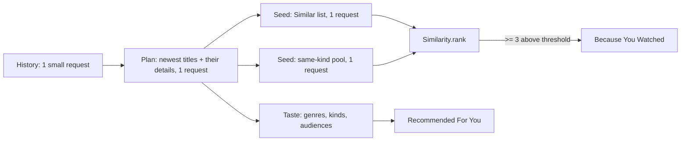

# Recommendations

## What it does
Home rows **"Because You Watched <title>"** and **"Recommended For You"**, personal to each profile.
A title appears only with a clear reason; a row with fewer than 3 close matches is left out rather
than padded with unrelated titles.

## The problem this update fixed
"Because You Watched *Charlotte*" (an anime) showed *The Inbetweeners* and *Adventure Time*. The old
ranking took Jellyfin's Similar list and kept anything sharing **one** genre with the seed, and added
the other kind (films for a show) by genre overlap. Charlotte's genres (Animation, Comedy, Drama,
Sci-Fi & Fantasy) share "Comedy" with a British sitcom and "Animation"/"Comedy" with a kids' cartoon.

## How it works now

1. **Plan** (`RecommendationService.plan`): recently finished titles (one request), then the newest
   8 titles' details — genres, tags, description, origin, original title, studios, age rating,
   provider ids — in one `ids=` request.
2. **Content kind** (`playback/ContentKind.kt`): Anime (anime database id, "Anime" genre/tag, or
   animated *and* Japanese: made in Japan, Japanese original title, Japanese audio), other
   Animation, or Live action.
3. **Candidates per seed**: Jellyfin's Similar list (it also weighs cast, crew and studios) plus
   unwatched titles of the same kind (anime → the Anime/Animation genres; live action → the seed's
   own content genres), up to 60, with the comparison fields.
4. **Score** (`recommend/Similarity.kt`):

| Part | Weight | Notes |
|---|---|---|
| Genre overlap | 0.45 (0.55 without tags) | weighted Jaccard; rare genres count more (IDF over the candidates); Animation/Anime excluded (the kind covers them) |
| Tag/keyword overlap | 0.2 | only when both have tags |
| Description similarity | 0.35 (0.45 without tags) | TF-IDF cosine of distinctive words (stop words removed, plurals folded), doubled and capped at 1 |
| Bonuses | +0.06 each | in Jellyfin's Similar list; a studio in common |
| × Kind factor | 1 / 0.35 / 0.3 / 0.2 | same kind / anime↔animation / animation↔live / anime↔live |
| × Audience factor | 0.5 or 0.8 | children's ↔ teen/adult 0.5; family ↔ adult 0.8 (from the age rating, else Kids/Family genres) |
| + Rating | 0.005 × community rating | a tie-break only (at most +0.05) |

   A candidate needs a **reason** (genre overlap ≥ 0.25, tag overlap ≥ 0.2 or description ≥ 0.15)
   and a score ≥ **0.25**. Watched, in-progress and already-shown titles are excluded; each title
   appears in one row only.
5. **Recommended For You** (`RecommendationEngine.taste` / `rankForTaste`): genre profile from the
   history (newer, favourites, thumbs-up and own ratings count more; thumbs-down counts against),
   multiplied by the share of the profile's viewing in the candidate's kind (0.2 + 0.8 × share) and
   halved for children's titles when the profile doesn't watch them. Kept when ≥ 0.15 with a genre
   match ≥ 0.2.

### Worked example (unit test `becauseYouWatchedAnAnimeMeansAnimeWithSimilarStories`)
| Candidate | Kind | Score | Shown |
|---|---|---|---|
| Angel Beats! (anime; school, special abilities, drama) | same | 0.79 | ✅ |
| Erased (anime; an ability, school days, mystery drama) | same | 0.33 | ✅ |
| a ramen-shop anime (only "Comedy" in common) | same | 0.21 | ❌ no clear reason |
| Adventure Time (Western cartoon) | ×0.35 | 0.12 | ❌ |
| The Inbetweeners (live-action sitcom) | ×0.2 | 0.08 | ❌ |

## Relevant files
`recommend/Recommendations.kt` (RecommendationEngine, RecommendationService), `recommend/Similarity.kt`,
`playback/ContentKind.kt`, `ui/screens/Home.kt` (recommendationRails), `jellyfin/JellyfinApi.kt`
(`Fields.SIMILARITY`, `similar(fields)`).

## Dependencies
[[Watch History]] · [[Home Page]] · [[API Endpoints]] · [[User Profiles]]

## Data storage
`recommendations-<profile>.json`: the finished rows and a **signature** of the history (plus the
algorithm version, so the new ranking recomputes once). While the history is unchanged, a launch
costs only the history request.

## Performance considerations
Same request count as before (per seed: Similar + one pool; plus two plan requests), slightly larger
responses (tags, description). Scoring ~80 candidates is a few milliseconds on the device; nothing
runs on the server beyond ordinary item queries. No model, no catalogue download, no outside service.

## Known limitations
- Quality depends on the library's metadata: with no descriptions or tags, only genres and kind are
  compared, and rows may simply not appear.
- Descriptions are compared word by word (English stop words); other languages work less well.
- In a small library, rows are often shorter or missing — intended.

## Related notes
[[Home Page]] · [[User Profiles]] · [[Caching Strategy]] · [[Change Log]]
