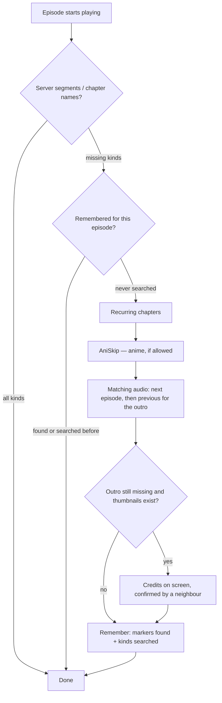

# Skip Markers (Skip Intro / Skip Outro)

## What it does
Marks intro, recap and outro (end credits) sections on the timeline in yellow and shows **Skip
Intro**, **Skip Recap** and **Skip Outro** buttons at the right moment. When the credits run to the
end of the episode and there's a next one, the button says **Next Episode** instead; when something
follows the credits (a post-credits scene, a "next time" preview), **Skip Outro** jumps to it and never
past it.

## Where markers come from (best first)
Later sources only fill kinds the earlier ones lack.
1. **Server media segments** (`/MediaSegments/{id}`, e.g. the Intro Skipper plugin).
2. **Chapter names** ("Opening", "Ending", "Credits", "Outro"…).
3. **Detection on the device** (`SkipDetector`), for whatever is still missing:

| Step | Finds | How | Server cost |
|---|---|---|---|
| Recurring chapters | intro, outro | an unnamed chapter of the same length (±1.5 s) in other episodes of the season, near the start / end | none (chapter list) |
| AniSkip (anime only, optional) | intro, outro, recap | crowd-sourced times by MyAnimeList id | none (online service) |
| Matching audio | intro, outro | low-rate audio (8-bit mono, 4 kHz) of this episode and a neighbour → band-shape fingerprints (`AudioFingerprint`) → the longest shared stretch (≥ 12 s) | small audio-only windows (~4 KB/s): intro window ≤ 10 min, outro window ≤ 4 min |
| **Credits on screen** (new) | outro | the server's **trickplay thumbnails** of the last quarter (≤ 10 min): "text on black" frames (`CreditsVision`), confirmed by a stretch of similar length in a neighbouring episode | static thumbnail sheets the server already made (1–2 JPEGs per episode); nothing decoded or transcoded |

## Why outros failed on live-action shows, and what changed
- **Different music every episode.** Many live-action shows play a different song (or no music) over
  the closing credits, so there's nothing shared to hear. → The **on-screen check** looks for the
  credits' *look* instead: white/grey thin text on black.
- **Only one neighbour was compared.** A finale or a special ending made the single comparison fail.
  → The outro now tries a **second neighbour** (this episode's audio is fetched once).
- **An intro-only result stopped all further searching.** Once markers were remembered for an
  episode (found while comparing with a neighbour), detection never ran again, so a missing outro
  stayed missing. → Markers now remember **which kinds were searched**; only kinds never searched are
  looked for. Entries from before this update count as "not searched", so they get one more try.

## The on-screen check (`playback/CreditsVision.kt`)
Each thumbnail (decoded at half size, ~160×90) is classed from a few pixel statistics:
- **Credits**: ≥ 78% near-black, 0.4–20% bright pixels, ≤ 18% mid-tones, the bright pixels are
  colourless (white/grey text), and they're **thin**: ≥ 0.5 dark↔bright changes per bright pixel
  along each row (text strokes; a lamp or the moon in a night scene is a blob and fails this);
- **Black**: ≥ 98% black (fades);
- **Scene**: anything else.

A stretch counts as credits when it is a run of Credits/Black thumbnails (single-frame interruptions,
e.g. a coloured company logo, are tolerated) with ≥ 3 Credits frames, at least half the run, lasting
≥ 30 s, starting after 70% of the runtime and ending within 4 minutes of the end. **It must be
confirmed**: the next (or previous) episode has a stretch of similar length (≥ 60% of the longer one,
or within 20 s). A dark ending in one episode is never enough.

Times are conservative: the outro starts at the first credits thumbnail (never earlier). If something
follows it, it ends one second after the last credits thumbnail, so the skip lands before the next
scene starts (it may leave a few seconds of credits). If it runs to the end, it ends at the end.

## Accuracy over coverage
- No outro is ever assumed from "the last few minutes".
- Anything unconfirmed shows no button: missing an outro is preferred to skipping story.
- Auto-skip (Settings → Playback → *Skip intro: Automatic*) applies to intros and recaps only; outros
  always wait for a press.

## Reuse (no repeated analysis)
- The neighbour compared with gets its markers too. The **next** episode is preferred, so when it's
  played next its markers are already there and nothing is fetched or analysed for it. Binge-watching
  analyses about every other episode.
- Results, including "searched, nothing found", are kept per profile (`skip-markers-<profile>.json`)
  while an episode is in progress, so resuming never repeats a search. Finished episodes' entries
  are deleted; untouched ones go after 30 days.
- The season's episode list is fetched once per detection and shared by every step.

## Relevant files
`playback/SkipDetector.kt`, `playback/AudioFingerprint.kt`, `playback/CreditsVision.kt`,
`playback/PlayerController.kt` (merge, remember, `creditsRunToEnd`), `profiles/ProfileStores.kt`
(SkipMarkerStore), `ui/screens/player/PlayerChrome.kt` (buttons), platform `decodeImagePixels`
(`ImagePixelsAndroid.kt`, `ImagePixelsJvm.kt`).

## Performance considerations
Detection starts only after playback has started and never blocks it (real-time timeouts: AniSkip
8 s, audio 90 s, screen 60 s). The screen check runs only when the outro is still missing and the
server has trickplay for both episodes; it decodes ≤ 2 sheets per episode at half size.

## User interactions
Settings → Playback → *Skip intro* (button / automatic / off), *Find intros and outros automatically* (audio and
screen checks), *Find anime openings online* (AniSkip).

## Known limitations
- The screen check needs trickplay thumbnails (library setting *Enable trickplay image extraction*,
  Jellyfin 10.9+). Without them, live-action outros with changing music can't be found.
- Credits over the final scene, in colour, or on a non-black background aren't recognised (missed,
  never mis-skipped).
- Thumbnails are ~10 s apart, so an outro found on screen can start up to ~10 s late.
- Verified in CI on generated test episodes only; not yet on a real library (see [[Known Issues]]).

## Related notes
[[Video Player]] · [[Playback Issues]] · [[Server Overview]] · [[Change Log]]
