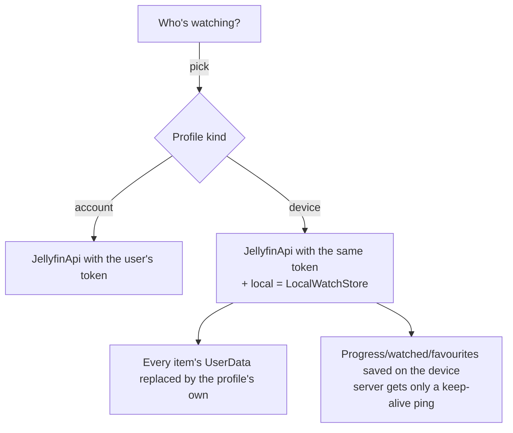

# User Profiles

## What it does
"Who's watching?" with Netflix-style profiles. Two kinds:

| | Account profile | Device profile (new) |
|---|---|---|
| What it is | A Jellyfin user signed in on this device | A name + picture added on this device under an existing sign-in |
| Needs a server account? | Yes | **No** (no administrator needed) |
| Watch history, Continue Watching, Next Up, favourites | On the server, for that user | On this device, its own |
| Settings, subtitles, ratings, search history | On this device | On this device |

## How it works

- `SessionManager` keeps `SavedUser.localProfiles` (id, name, avatar) and
  `lastLocalProfileId`. `Profile(server, user, local)`; its `key` gets a `-p<id>` suffix for device
  profiles, so all per-profile files are separate.
- Opening a device profile creates a `JellyfinApi` with the account's token and
  `api.local = LocalWatchStore(...)`. Switching between profiles of the same sign-in needs no
  server round trip.
- **The overlay** (`JellyfinApi.withLocal`) replaces `UserData` on every item the app receives.
  Queries that depend on watch state are rewritten: favourites → `ids=`, watched → `ids=`,
  in progress → `ids=` (most recent first), unwatched → `excludeItemIds=`. Continue Watching is
  fetched as plain items by id; Next Up is worked out from the series the profile watched: for each (up
  to 8, in parallel) one request for the few episodes after the last one it finished.
- **Nothing is written to the account.** Playback start/progress/stop, "Mark watched" and
  favourites go to the profile's file; during playback only `/Sessions/Playing/Ping` is sent so the
  server keeps a transcode alive.
- "Add profile" opens a small editor (name + picture). "Sign in another account" is still there for
  separate Jellyfin users. With nobody signed in yet, Add profile goes to sign-in.
- Removing a device profile deletes its files; removing an account also removes the device
  profiles under it (they can't work without its sign-in).

## Relevant files
`data/SessionManager.kt` (LocalProfile, Profile, UserSession, addLocalProfile, selectProfile,
removeProfile), `jellyfin/LocalWatchData.kt`, `profiles/LocalWatchStore.kt`,
`jellyfin/JellyfinApi.kt` (overlay), `ui/screens/Profiles.kt`, `ui/AppContainer.kt` (onActivate,
onProfileRemoved), `profiles/ProfileStores.kt`.

## Dependencies
[[Watch History]] · [[Data Storage]] · [[Recommendations]] · [[Home Page]]

## Data storage
`servers.json` (profiles list, no secrets) · tokens only in the secure vault (Android Keystore /
Windows DPAPI), one per account (device profiles add none) · per-profile files
`<base>-<profile key>.json` (settings, tracks, ratings, skip markers, search history,
recommendations, watch).

## Performance considerations
A device profile's Next Up costs one small request (≤ 6 episodes) per recently watched series (≤ 8). Id lists
sent to the server are capped at 100 to keep URLs short.

## User interactions
Profile button (top right, Up from the top of any screen) → "Who's watching?". *Manage profiles*
renames, changes the picture or removes. *Ask on start* toggles the picker at launch.

## Known limitations
- Device profiles live on one device; they don't follow you to another TV.
- The server's own dashboards (and other Jellyfin apps) show activity under the account's name.
- "Thumbs" and personal star ratings from the server aren't per device profile.
- A series counts as watched for a device profile only when marked; finishing every episode doesn't
  mark the series itself.

## Future improvements
Export/import a device profile's history; optional PIN per profile.

## Related notes
[[Watch History]] · [[Data Storage]] · [[Change Log]]
