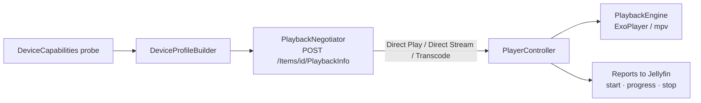

# Video Player

## What it does
Plays movies and episodes with hardware decoding: **Media3/ExoPlayer** on Android/Fire TV (MPV is
an opt-in alternative on Android 8+), **libmpv** on Windows. Shows a frosted control overlay with
the timeline, tracks, episode list, skip buttons and "Next Episode".

## How it works

1. Device capabilities are probed once per launch and turned into a Jellyfin `DeviceProfile`.
2. The server decides Direct Play, Direct Stream (remux) or Transcode (HLS). H.264 is listed first
   for transcodes because HEVC encodes are much slower on home servers.
3. `PlayerController` loads the stream, picks audio/subtitle tracks ([[Subtitles]]), seeks to the
   resume point ([[Playback Resume]]) and reports playback (every 10 s and on pause).
4. Skip markers ([[Skip Markers]]) and "Are you still watching?" (`StillWatching`) run alongside.

Buffering: Media3 buffers up to 2 min / 160 MB ahead and keeps 15 s behind; mpv keeps a 400 MiB
forward / 100 MiB back cache. Seeks go to the nearest keyframe.

## Relevant files
`playback/` (PlayerController, PlaybackNegotiator, PlaybackPreparer, DeviceProfileBuilder,
TrackSelector, StillWatching), `ui/screens/player/` (PlayerScreen, PlayerChrome,
TrickplayFrames), `androidMain/.../ExoPlayerEngine.kt`, `MpvAndroidEngine.kt`,
`DolbyVisionPlayback.kt`, `FrameRateMatcher.kt`, `desktopMain/.../MpvEngine.kt`, `LibMpv.kt`.

## Dependencies
[[API Endpoints]] (PlaybackInfo, Videos, Sessions/Playing) · [[Streaming Performance]] ·
[[UI Sounds]] (silenced while the player is open).

## Data storage
Nothing of its own except remembered tracks ([[Subtitles]]) and detected skip markers
([[Skip Markers]]). Watch progress goes to the server, or, for a device-only profile, to that
profile's file on the device ([[Watch History]]).

## Performance considerations
- Engines publish position at most ~4×/s and only the timeline reads it; with controls hidden the
  overlay doesn't redraw.
- Scrub thumbnails decode one tile from a trickplay sheet, never the whole sheet.
- A transcode is stopped on the server (`DELETE /Videos/ActiveEncodings`) when playback ends.

## User interactions
OK/Enter: show controls / play-pause. Left/Right: seek (hold to accelerate; commits 0.45 s after the
last press). Down: straight to the Episodes panel (series) or Info; Up: show controls. Back: hide controls, then leave.

## Known limitations
Subtitle delay isn't available on Android; Dolby Vision and HDR output are untested on real
hardware. See [[Known Issues]].

## Future improvements
Audio delay control; per-title playback speed.

## Related notes
[[Playback Resume]] · [[Subtitles]] · [[Skip Markers]] · [[Playback Issues]] · [[Streaming Performance]]
