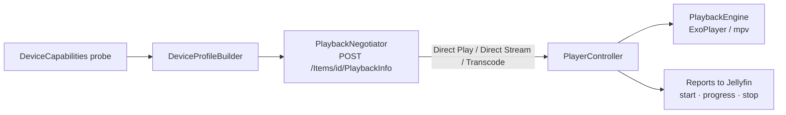

# Video Player

## What it does
Plays movies and episodes with hardware decoding: **Media3/ExoPlayer** (MPV is an opt-in alternative
on Android 8+). Shows a frosted control overlay with
the timeline, tracks, episode list, skip buttons and "Next Episode".

## How it works

1. Device capabilities are probed once per launch and turned into a Jellyfin `DeviceProfile`.
2. The server decides Direct Play, Direct Stream (remux) or Transcode (HLS). H.264 is listed first
   for transcodes because HEVC encodes are much slower on home servers.
3. `PlayerController` loads the stream, picks audio/subtitle tracks ([[Subtitles]]), seeks to the
   resume point ([[Playback Resume]]) and reports playback (every 10 s and on pause).
4. Skip markers ([[Skip Markers]]) and "Are you still watching?" (`StillWatching`) run alongside.

Buffering: Media3 buffers up to 2 min / 160 MB ahead and keeps 15 s behind; mpv keeps 150 MiB ahead
and 50 MiB behind (96/24 MiB on low-RAM devices). Seeks go to the nearest keyframe.

## Episodes inside a file
A virtual episode plays its stretch of the file through `ClippedEngine`: its own 0:00–end timeline,
seeks kept inside it, the engines stopping exactly at its end, and skip markers and chapters moved
onto it ([[Virtual Episode Splitting]]).

## Audio track choice
`PlaybackPreparer` picks the audio track, in this order:
1. A track picked by hand earlier for this series or movie ([[Subtitles]] → TrackMemory).
2. Settings → Playback → *Audio language*, when a language is set.
3. **Automatic** (the default): **English** for everything except anime; anime keeps the file's own
   default track (normally its original Japanese). Whether a title is anime comes from `ContentKind`
   (anime database ids, an "Anime" genre/tag, or animated *and* Japanese). For an episode the series
   is looked up once (one small request, remembered for the session), and only when it matters: the
   file has an English track, more than one audio track, and a default that isn't already English.
4. The server's default track, else the file's default.

## Relevant files
`playback/` (PlayerController, PlaybackNegotiator, PlaybackPreparer, DeviceProfileBuilder,
TrackSelector, StillWatching), `ui/screens/player/` (PlayerScreen, PlayerChrome,
TrickplayFrames), `androidMain/.../ExoPlayerEngine.kt`, `MpvAndroidEngine.kt`,
`DolbyVisionPlayback.kt`, `FrameRateMatcher.kt`, `playback/ContentKind.kt` (anime or not, for the audio default).

## Dependencies
[[API Endpoints]] (PlaybackInfo, Videos, Sessions/Playing) · [[Streaming Performance]] ·
[[UI Sounds]] (silenced while the player is open).

## Data storage
Nothing of its own except remembered tracks ([[Subtitles]]) and detected skip markers
([[Skip Markers]]). Watch progress goes to the server, or, for a device-only profile, to that
profile's file on the device ([[Watch History]]).

## Performance considerations
- Engines publish position at most ~4×/s and only the timeline reads it; with controls hidden the
  overlay doesn't redraw.
- Scrub thumbnails decode one tile from a trickplay sheet, never the whole sheet.
- A transcode is stopped on the server (`DELETE /Videos/ActiveEncodings`) when playback ends.

## User interactions
OK/Enter: show controls / play-pause. Left/Right: seek (hold to accelerate; commits 0.45 s after the
last press). Down: straight to the Episodes panel (series) or Info; Up: show controls. Back: hide controls, then leave.

## Known limitations
Subtitle delay isn't available on Android; Dolby Vision and HDR output are untested on real
hardware. See [[Known Issues]].

## Future improvements
Audio delay control; per-title playback speed.

## Related notes
[[Playback Resume]] · [[Subtitles]] · [[Skip Markers]] · [[Playback Issues]] · [[Streaming Performance]]
