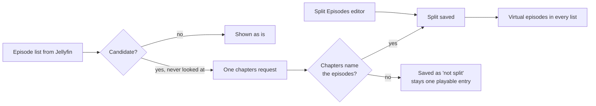

# Virtual Episode Splitting

## What it does
Some files hold two or more short episodes, which is common with cartoons: two 11-minute episodes in
one 22-minute file. Sharkfin shows and plays each one as a normal episode, with its own number,
title, length, thumbnail, progress, watched mark, Continue Watching card and Next Episode. The file
is never touched: nothing is cut, copied or re-encoded, and no transcoding is added. A virtual
episode streams its stretch of the original file.

Two situations are handled:

| Situation | What Jellyfin shows | What Sharkfin does |
|---|---|---|
| **A: one entry, several episodes** (`S01E01-E02.mkv`) | One 22-minute episode numbered 1–2 | Replaces it in every list with one virtual episode per part (`vep~<item>~<k>`) |
| **B: several entries, one file** | Episode 1 and Episode 2, both playing the whole file | Keeps the server's entries and metadata (no duplicate cards); each plays only its own part |

## How it works

**Detection** (`VirtualEpisodes.candidates` / `decide`, run by `JellyfinApi.episodes`):
- **Candidates:**
  - an entry numbered as several episodes (`IndexNumberEnd`);
  - a file name listing several (`S01E01-E02`, `S01E01E02`, `S01E01-02`);
  - several entries with the same `Path` (the episodes request asks for `Path` for this).
- **Boundaries come from chapters only.** A file is split only where chapters name the episodes:
  - "Episode 2", "Ep. 14", "Part 2", "Segment 2", or the episode's title;
  - "Part A/B" (the halves of one anime episode) doesn't count;
  - every part must be at least 3 minutes long.
- **No guessing.** A file is never split in half or by length. When chapters don't say where the
  episodes start, the file stays one playable entry, and the decision is still saved so that file
  isn't looked at again.
- **Cost:** one small request per season, only when it has undecided candidates
  (`/Items?ids=…&fields=Chapters,Path`). No video or audio is analysed.

**Manual configuration:** on an episode's page, use **Split Episodes** (or **Edit Split** once it's
split), which opens `ui/screens/SplitEditor.kt`.
- **Number of episodes:** 2–6. A shared-file group has one per server entry.
- **Each episode:**
  - its number and title (title only when the server has no entry of its own);
  - its start and end, adjusted with steps from −1 min to +1 min or a jump to the next chapter mark.
- **Starting values:**
  - chapters that name the episodes;
  - else one chapter per episode (only ever a suggestion);
  - else even divisions, clearly labelled as needing adjustment.
- **Checking:** **Preview start** and **Preview end** play the whole file from that point. Nothing is
  reported or remembered during a preview (`Route.Player.previewAtMs`).
- **Save** checks that episodes are in order, don't overlap, each is at least 30 s long, and none
  ends after the file does.
- **Remove Split** saves the file as "not split by hand", so detection never splits it again on its
  own.

## Data and mappings
- **`episode-splits-<server>.json`** (`SplitStore`): one per server, shared by its profiles, because it
  describes files, not viewing.
  - **Key:** the file's item id, or the first entry of a shared-file group.
  - **Value:** `EpisodeSplit`: the file's runtime, its parts (`SplitPart`: start/end ms, number, title,
    server entry id, chapter thumbnail), manual or automatic, the reason, and the group's entries.
  - **Matched to the right file:** a split applies only while the item's runtime is within 2 s of
    the saved one, so a replaced file never inherits an old mapping, and ids are per server.
- **`split-watch-<profile>.json`** (a `LocalWatchStore`): each profile's own progress per virtual
  episode. It's removed with the profile (`ProfileFiles.ALL`).
- **Ids:** `VirtualIds.of(file, k)` = `vep~<file>~<k>`. `VirtualIds.serverId` turns any id back into
  the server's item, which is used for playback info, images, trickplay, segments, fonts,
  favourites and Similar. A shared-file entry keeps its real id.

## Timeline and playback
`ClippedEngine` wraps the engine for the whole playback session (`PlayerController`), and a
virtual episode sets its `Window(startMs, endMs)`:

| Episode 2 = 11:00–22:00 of the file | |
|---|---|
| Player timeline | 0:00–11:00 (positions and duration are the episode's) |
| Resume at 2:00 | the engine loads the file at 13:00 |
| Seek to 5:00 | the file seeks to 16:00 |
| Seeking past either end | clamped to the episode |
| End | Media3 gets an end-only `ClippingConfiguration`, mpv gets `end=`, and both stop exactly at 22:00, reported as ended (a 0.3 s backstop in the controller if not) |
| Transcode | the server's start point is the file position (`PlaybackPreparer`, renegotiation, retry) |

- **Subtitles and audio** are the file's own, so they stay in sync with no extra handling.
- **Trickplay** previews add the window's start (`TrickplayRef.offsetMs`).
- **Chapters** are moved onto the episode's timeline, and their images keep the file's numbering
  (`ImageUrls.chapter(item, …)`).
- **Skip markers** are the file's: the server's segments, chapter names, remembered or detected (on
  the whole file, stored under the file's id). They're moved onto the episode's timeline and cut at
  its ends, and anything under 3 s is dropped (`PlayerController.clipRanges` / `clipSegments`). A
  marker can never reach into the next episode, and credits cut at the episode's end become
  "Next Episode".
- **Next Episode / autoplay:** `episodes(startItemId = <virtual id>)` asks from the file and returns
  the following part, and after the last part, the next episode of the season.

## Progress and Jellyfin
Jellyfin has one position per item, which can't describe two episodes, so:
- **Kept on the device:** a virtual episode's start, progress and stop are recorded per profile on
  the device. Jellyfin's own resume point for the file is never moved, and only a keep-alive ping
  goes to the server for a transcode.
- **Rules:** the usual ones apply. Under 5% isn't a resume point, and 90% or more counts as watched.
- **What the server learns:** "watched". A shared-file entry is marked when its part is finished,
  and a split file when all its parts are. Unmarking a part unmarks the file or entry on the server
  too.
- **Before any progress here,** the file's server state carries over: a watched file means its parts
  are watched, and a resume point inside a part is that part's.
- **Continue Watching:** parts in progress replace the file. One request is made for their files,
  only when there are any, sorted by when each was last watched.
- **Next Up:** a split file is shown as its first unfinished part. A part already started is left
  to Continue Watching on Home, but a series' own Play button resumes it.
- **Profiles:** every profile, including device-only ones, has its own `split-watch` file.

## Performance
- **No split anywhere:** `expand` returns the same list (`SplitStore.anySplit`), with no other work.
- **No new background work:** the only additions are one chapters request per season with
  undecided candidates (once) and `Path` on episode lists.
- **Playback:** the same stream, the same Direct Play, and the same prewarming.
- **Files:** both are small JSON files, read once and written on change.

## Relevant files
- `jellyfin/VirtualEpisodes.kt` (VirtualIds, SplitStore, VirtualEpisodes)
- `jellyfin/JellyfinApi.kt` (`virtual`, `episodes`, `decideSplits`, `withVirtualResume`, `nextUp`,
  reports, `fileItem`)
- `jellyfin/ImageUrls.kt`
- `playback/ClippedEngine.kt`, `playback/PlayerController.kt`, `playback/PlaybackPreparer.kt`
- `ui/screens/SplitEditor.kt`, `ui/screens/Detail.kt` (button)
- `data/SessionManager.kt` (wiring)
- Android engines (`endPositionMs`)

## Testing
- **Unit tests** (`VirtualEpisodesTest`):
  - file names and chapter names;
  - situation A split by named chapters, with no duplicate cards, the right names, numbers,
    durations and thumbnail;
  - no split without reliable chapters;
  - independent progress, with the server marked only when both parts are done;
  - per-profile progress;
  - Next Up, Continue Watching and next-episode order;
  - situation B (entries keep their ids, each plays its part, the right entry is marked watched);
  - manual splits surviving a restart and not following a replaced file;
  - the clipped timeline (resume offset, seeks clamped, end);
  - skip markers cut at the episode's ends.
- **CI against a real Jellyfin** (sample series *Paper Town*: `S01E01-E02` with chapters "Episode 1/2",
  `S01E03`, and `S01E04-E05` without):
  - the split, windows and next episodes;
  - Direct Play of the file;
  - independent progress, with the server's file untouched;
  - Continue Watching;
  - the emulator plays part 2 and checks the engine starts at 4:00 of the file.

## Known limitations
- **Situation B isn't covered by CI:** it can't be produced on the CI server, which makes one item
  per multi-episode file, so it's covered by unit tests with a fake server only.
- **The server's "Now playing" dashboard** doesn't show virtual episodes (positions aren't
  reported).
- **Other devices:** progress for parts is per device and profile, so another Jellyfin client
  sees only the file's watched mark.
- **Metadata:**
  - only the first part gets the file's description (the server stores the first episode's), and
    others get none rather than a wrong one;
  - titles come from "Title A / Title B" names or the editor;
  - thumbnails for later parts need chapter images on the server.
- **Not checked on a Fire TV,** and the editor's time steps haven't been tried with a real remote.

## Troubleshooting
- **A file isn't split:** its chapters don't name the episodes. Use **Split Episodes** on the
  episode's page.
- **A wrong split:** use **Edit Split**, or **Remove Split** (it stays removed).
- **Progress looks lost after replacing a file:** the new file's length differs, so its old split
  (and its parts' progress) no longer applies. Split it again.

## Related notes
[[Episode Browser]] · [[Video Player]] · [[Watch History]] · [[Skip Markers]] · [[Playback Resume]] ·
[[User Profiles]] · [[Data Storage]] · [[API Endpoints]]
