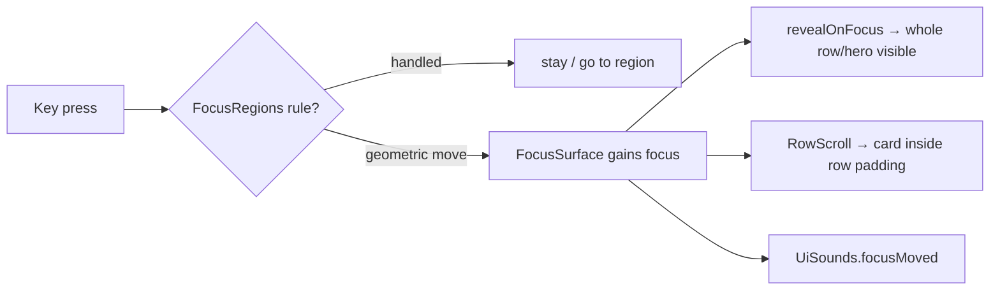
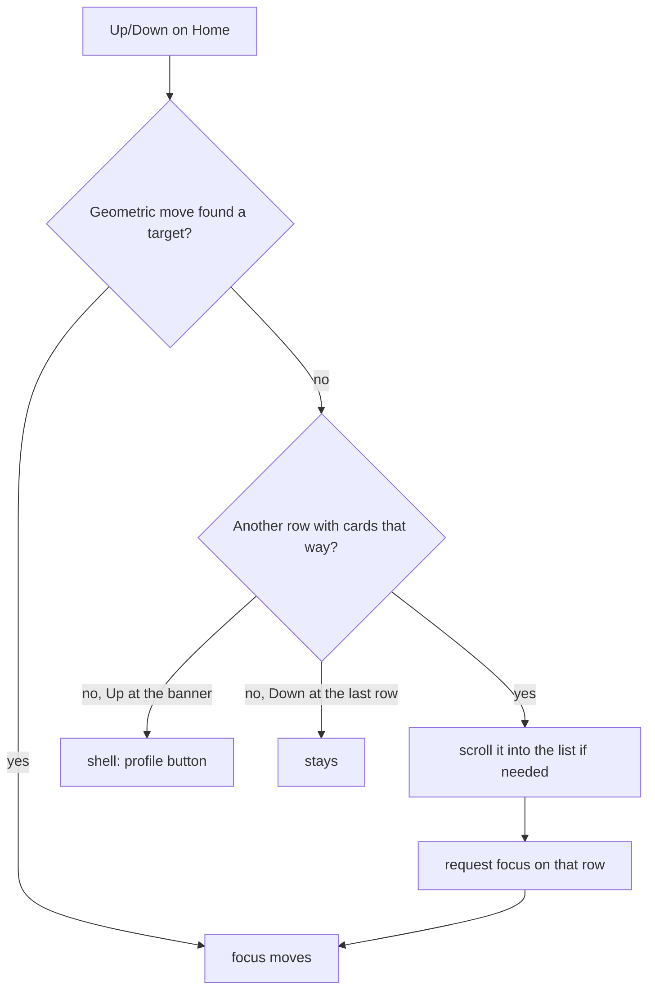

# Focus Management

## Building blocks
- **`FocusSurface`** (`ui/components/Focus.kt`): every focusable thing. Same lift/ring/shadow for
  D-pad, keyboard and mouse; scale through `graphicsLayer`. Plays [[UI Sounds]].
- **`FocusRegions`** (`ui/nav/FocusRegions.kt`): sidebar, content, header with explicit rules
  (Right/Down past the content edge stays put; rows keep Right at their last card; the header is
  reachable only via Up from the top).
- **`FocusMemory`** per back-stack entry and `focusRestorer` on rows: Back and Up/Down return to
  the last-focused card.

## Scrolling focus into view (this update)
- **`RowScroll`**: a `BringIntoViewSpec` per horizontal row that keeps the focused card inside the
  row's own content area (from the row's start padding to its end padding), not merely on screen.
  Coming back from the end of a row, the first card lands exactly where it started instead of
  under the sidebar. Used by Home rows, season/cast/review rows, brand rows and search chips.
- **`revealOnFocus()`**: when focus enters an element (a row with its heading, the details hero, an
  episode with its description), the whole element is brought into view, then asked again 260 ms
  later in case the child's smaller request was handled last.
- **Details hero settle:** when the hero regains focus, after 450 ms the page scrolls to the very
  top if it isn't there (`HERO_SETTLE_MS`).

## Home rows: a path that can't break (Nov 2026)
Compose moves focus by geometry among what's composed. A `LazyColumn` composes the rows on screen
and, when the search finds nothing, lays out extra items one at a time, but only up to about two
screens' worth of **items** (`BeyondBoundsViewportFactor` × items per viewport). Home used to keep
loading placeholders and zero-height empty rows in its list, so a few of them between two real rows
used up that allowance: the search found nothing, and the shell's rule "Up that finds nothing = top
of the screen → profile button" fired from the middle of Home (Down just stopped).

`ui/screens/HomeFocus.kt`:
- **`shownRails`**: rows that loaded empty aren't list items at all.
- **`HomeRowFocus`**: one `FocusRequester` per stop (banner Play, brand tiles, each row's
  `LazyRow`, a row's Try Again button), and which stop has focus (set by `onFocusChanged` on each).
- **`homeRowNavigation`** (on Home's `LazyColumn`, an `onKeyEvent` that sees Up/Down before the
  shell): first the normal geometric move; if that finds nothing, `HomeRowFocus.next` picks the next
  stop with cards in that direction (`homeStops`, in list order, placeholders skipped), scrolls it
  into the list if it isn't composed, and requests focus on it (its `focusRestorer` returns to its
  last card). Only when there's no stop above (the banner) does Up fall through to the shell, which
  opens the profile button. Presses while such a move finishes are consumed, so held or rapid
  presses can't skip past it or leak to the profile button.
- **Recovery:** when Home loses focus and, two frames later, nothing on Home has it and it didn't go
  to the sidebar, the profile button, another screen or the update card (`mayRecover`),
  `HomeRowFocus.nearest` puts it on the same row, else the closest row (the one now in its place
  first). The shell's own safety net (focus nowhere for 250 ms → the content) still exists for
  other screens.

Tests: `jvmTest/HomeNavigationTest.kt` (the shell's real focus rules with Home's own rows) and the
emulator check "Home: down every row and back up the same way" (`ci/android_e2e.sh`).

## Tracing
Launch with `--ez traceUi true` (CI) to log `AuroraLayout` positions (first card x vs row start,
"revealed top=", details hero item/offset), `UiSound` events and the Home rows focus passes
through (`HomeFocus: row=…`).

## Related notes
[[Navigation System]] · [[Navigation Bugs]] · [[UI Layout Issues]]
