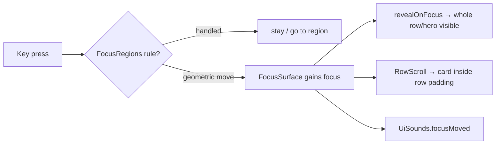

# Focus Management

## Building blocks
- **`FocusSurface`** (`ui/components/Focus.kt`): every focusable thing. Same lift/ring/shadow for
  D-pad, keyboard and mouse; scale through `graphicsLayer`. Plays [[UI Sounds]].
- **`FocusRegions`** (`ui/nav/FocusRegions.kt`): sidebar, content, header with explicit rules
  (Right/Down past the content edge stays put; rows keep Right at their last card; the header is
  reachable only via Up from the top).
- **`FocusMemory`** per back-stack entry and `focusRestorer` on rows: Back and Up/Down return to
  the last-focused card.

## Scrolling focus into view (this update)
- **`RowScroll`**: a `BringIntoViewSpec` per horizontal row that keeps the focused card inside the
  row's own content area (from the row's start padding to its end padding), not merely on screen.
  Coming back from the end of a row, the first card lands exactly where it started instead of
  under the sidebar. Used by Home rows, season/cast/review rows, brand rows and search chips.
- **`revealOnFocus()`**: when focus enters an element (a row with its heading, the details hero, an
  episode with its description), the whole element is brought into view, then asked again 260 ms
  later in case the child's smaller request was handled last.
- **Details hero settle:** when the hero regains focus, after 450 ms the page scrolls to the very
  top if it isn't there (`HERO_SETTLE_MS`).

## Tracing
Launch with `--ez traceUi true` (CI) to log `AuroraLayout` positions (first card x vs row start,
"revealed top=", details hero item/offset) and `UiSound` events.

## Related notes
[[Navigation System]] · [[Navigation Bugs]] · [[UI Layout Issues]]
