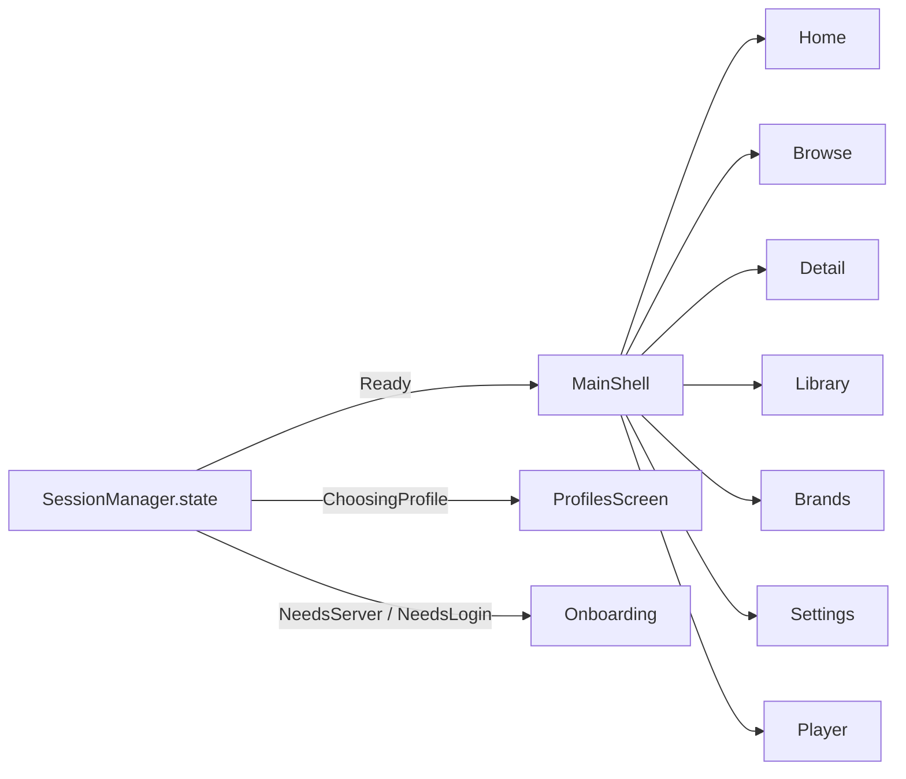

# Frontend Architecture

- **Compose Multiplatform** screens in `ui/screens/`; shared components in `ui/components/`
  (FocusSurface, ContentRail, cards, frosted backdrops, icons); theme in `ui/theme/`.
- **Shell** (`ui/App.kt`): `AuroraApp` loads fonts, sounds and the image loader (Coil 3); `MainShell`
  hosts the sidebar, the profile button, the current screen and the player, and owns the
  `FocusRegions`.
- **State:** each screen keeps a model object in its back-stack entry (`entry.model("home") { … }`),
  so data and scroll positions survive navigation. App-wide state is `StateFlow`s in services
  (settings, session state, `WatchActivity.version`).
- **Navigation:** `Navigator` (back stack of `Route`s: Root(section), Library, Brand, Detail,
  Player). See [[Navigation System]].
- **Rendering cost rules** used throughout: scale/alpha via `graphicsLayer` (no relayout on focus),
  `derivedStateOf` for values that change rarely, lazy rows/lists with small cache windows,
  artwork at real pixel size.

## Related notes
[[Focus Management]] · [[Design System]] · [[Performance Optimization]]
