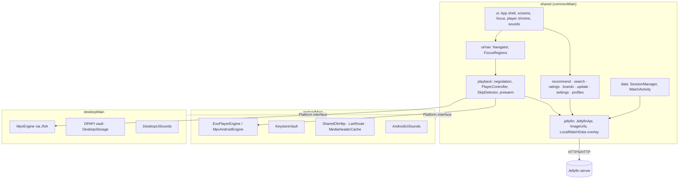

# System Architecture

Sharkfin is one Kotlin Multiplatform codebase with two thin native shells. The Jellyfin client,
state, UI and player controls are shared; only decoding/rendering, secure storage, capability
probing and a few platform services are native.

`AppContainer` (`ui/AppContainer.kt`) wires the services together; `AuroraApp`/`MainShell` in
`ui/App.kt` is the shell. The `Platform` interface (`platform/Platform.kt`) is everything a platform
must provide: file store, secure vault, capability probe, playback engine, player host, and optional
services (updater, UI sound output, request statistics, VPN detection, media-header prefetch).

## Related notes
[[Frontend Architecture]] · [[Backend Architecture]] · [[Data Storage]] · [[Project Structure]]
