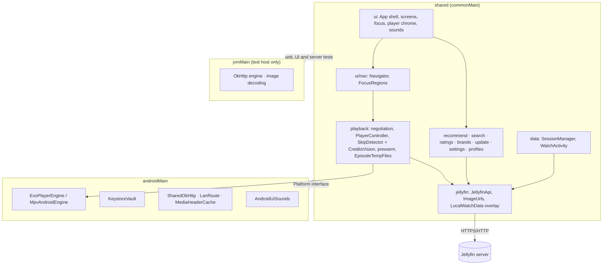

# System Architecture

Sharkfin is a Fire TV / Android TV app built as one Kotlin Multiplatform module plus a thin Android
shell. The Jellyfin client, state, UI and player controls are in the shared code; only
decoding/rendering, secure storage, capability probing and a few platform services are
Android-specific. The shared code also compiles for the JVM, which is used only to run tests (see
[[Supported Platforms]]).

`AppContainer` (`ui/AppContainer.kt`) wires the services together; `AuroraApp`/`MainShell` in
`ui/App.kt` is the shell. The `Platform` interface (`platform/Platform.kt`) is everything a platform
must provide: file store, secure vault, capability probe, playback engine, player host, and optional
services (updater, UI sound output, request statistics, VPN detection, media-header prefetch and
its disposable cache).

## Related notes
[[Frontend Architecture]] · [[Backend Architecture]] · [[Data Storage]] · [[Project Structure]]
