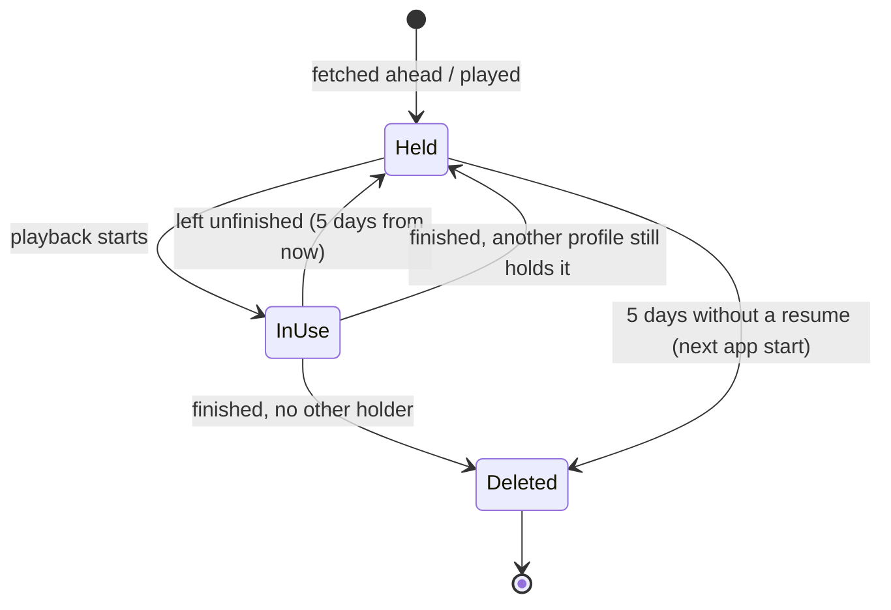

# Temporary File Lifecycle

## What counts as a temporary episode file
Classified from the code before any deletion was added:

| File | Where | Made by | Episode-specific? | Handling |
|---|---|---|---|---|
| **Saved start of a font-heavy MKV** (≤ 48 MB, before the first video cluster) | app cache `media-headers/` (Media3 SimpleCache) | `MediaHeaderCache` | yes (key = file id + size + ETag) | **managed here** (below) |
| Copies of the server's subtitle fonts for mpv (transcoded playback) | app cache `mpv-fonts/` | `MpvAndroidEngine` | yes, current playback only | deleted when the player closes (downloaded again for the next playback anyway) |
| Downloaded update APK | app cache `updates/update.apk` | `AndroidUpdater` | no | deleted at the next start once installed |
| Detected skip markers | `skip-markers-<profile>.json` | `SkipMarkerStore` | yes (a few bytes) | already: deleted when finished, pruned after 30 days untouched |
| Artwork, trickplay sheets | Coil disk cache `artwork/` (300 MB) | Coil | no | left alone: Coil's own size-limited LRU already manages it |
| mpv shader / fontconfig caches, UI sound files | app cache | mpv, `AndroidUiSounds` | no | left alone (reused by every playback; tiny) |

**Never touched by any cleanup:** original video and subtitle files (they live on the server; the app
only streams them), library metadata, watch history and resume points (server or `watch-<profile>.json`),
ratings, settings and subtitle styling, remembered tracks, profiles and tokens.

## Rules for the saved file starts (`playback/EpisodeTempFiles.kt`)
Each saved start is *held* by the profiles that may still need it, each hold with an expiry.

| Event | Effect |
|---|---|
| Fetched ahead (details page / resting on Continue Watching, resume point > 0) | held by this profile for **5 days** |
| Playback starts | marked **in use** (never deleted while playing); held 5 days |
| Left unfinished | the hold is **reset to 5 days from now** |
| Resumed within 5 days | the saved start is used again (fast resume); leaving again restarts the 5 days |
| Finished (≥ 90%, the server's "watched") | this profile's hold is dropped; deleted **at once** if no other profile holds it |
| 5 days pass without a resume | deleted at the next app start |
| Profile removed | its holds are dropped (files nobody else holds are deleted) |

## Ownership and safety
- One small JSON file, `temp-files.json`: `key → {item, holds: {profile key → expiry}}`. Written only
  when something changes (a renewal within an hour of the last is skipped).
- **Other profiles' holds and the playing file always protect a saved start.**
- Only keys of the app's own header cache (`hdr:` keys) can ever be deleted; the cache reports its
  keys from its index, no disk scan, no library scan.
- **Crash-safe order:** the file is deleted first, then its record. An interruption leaves either a
  record without a file (dropped by the next sweep) or a file without a record (adopted at the next
  sweep and kept another 5 days). Missing files are ignored.

## When it runs
Event-driven only: on playback start/stop, on prefetch, on profile removal, and **one sweep per app
start** (20 s after launch, after Home has loaded). No timers, no background service. All ledger work
runs on one background worker.

## Relevant files
`playback/EpisodeTempFiles.kt`, `androidMain/.../MediaHeaderCache.kt` (`disposable()`),
`playback/PlayerController.kt` (start/stop), `ui/AppContainer.kt` (prefetch, sweep, profile removal),
`androidMain/.../MpvAndroidEngine.kt` (fonts), `androidMain/.../AndroidUpdater.kt` (update APK).
Tests: `EpisodeTempFilesTest`.

## Known limitations
- The 5 days are wall-clock days from when the episode was last left; a device whose clock jumps can
  shorten or lengthen them.
- An expired file is deleted at the next app start, not exactly at the 5-day mark.
- Android may clear the app cache itself when storage runs low; the ledger then forgets those files.

## Related notes
[[Playback Resume]] · [[Caching Strategy]] · [[Data Storage]] · [[Resource Usage]]
