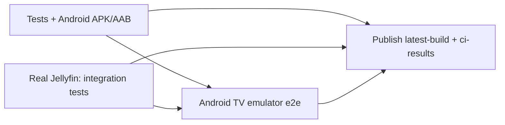

# Testing Guide

GitHub Actions (`.github/workflows/build.yml`) runs on every push (only `aurora-tv` publishes):

- **Unit tests** (`shared/src/commonTest`): fake Jellyfin via Ktor `MockEngine`. Covers API, sessions,
  profiles (incl. `LocalProfilesTest` for device-only profiles), playback decisions, skip detection
  (`CreditsVisionTest` for the on-screen outro check), fingerprints, recommendations (incl. the
  Charlotte case), the audio default (`AudioDefaultTest`), temporary files (`EpisodeTempFilesTest`),
  search, stores, updates, VPN address racing, subtitle choice (`SubtitleSelectionTest`: full vs
  Signs & Songs, SDH, only S&S, ambiguous names, dubs, missing metadata, hand-picked S&S on the next
  episode), virtual episodes (`VirtualEpisodesTest`), the performance audit's caches (`PerfAuditTest`: bounded, expiring, More Like This asked again after watching), the household Top 10 (`HouseholdTop10Test`: ranking by time watched lately then all-time, server and device histories, titles hidden from the viewer left out, caching, an administrator's every-account scope, no viewing yet → no row and nothing made up, refreshed after watching at most once a minute), new-profile recommendations (`RecommendationColdStartTest`: library's best across genres, favourites steer it, a failed request isn't saved), episode orders (`EpisodeOrderTest`: a Steven-Universe-like DVD order across seasons, verification against the library, intended-before-DVD, custom orders, split parts inside orders, persistence, TMDB simulated and unreachable, the banner's Play target), film subtitle fonts (`SubtitleThemesTest`),
  the recommendation cache (`RecommendationCacheTest`), air dates (`AirDatesTest`: time
  zones, aired/today, placeholders, Trakt merge) and audio edges (`AudioFingerprintTest`). They run on the JVM test host (`:shared:jvmTest`) and
  on Android (`:shared:testDebugUnitTest`).
- **JVM tests** (`jvmTest`): integration tests against a real Jellyfin in Docker (including intro +
  outro by listening on *Wavelength Street*, and the outro found on screen on *Harbor Precinct*, a
  generated live-action series whose credits music changes every episode and whose episode 2 has a
  post-credits scene). The listening check asserts edge accuracy (no story skipped), that Wavelength
  episode 3's credits stop before its 15 s post-credits scene, and logs per-step timings. There's also
  a diagnostic of where the server's mid-file audio starts (0 ms off on CI), an episode-order check on *Zephyr Bay* (an S02 episode moved into season 1: seasons, lists, Next Episode, Next Up, progress, the right file, reset), a check that the upcoming
  episodes request answers and invents nothing, keyboard navigation UI tests, a ratings UI test, and
  `HomeNavigationTest`: Home's rows with the shell's real focus rules, driven by the remote (down to
  the last row and back up; rows loading or empty skipped both ways; many placeholders in a row;
  rows finishing loading while focus is below; rows of different lengths; the focused card removed
  or its row emptied; rapid/held presses; a row that never answers ending in Try again).
- **Disc menus** (`MenuLogicTest`, `ShippedPackTest`): the menu's state machine with a small test
  pack (intro hand-off, transitions, skipping, page actions, chapters the server lacks, subtitles,
  Back, mouse, shutdown, credits layout) and the real pack's data (every button reachable with the
  arrows, no overlapping buttons, 35 chapter slots). Checks to do **on a Fire TV** (not covered by
  CI): sparkles blend over the video, loop and music loops are gapless, three decoders at once keep
  up, Back from the player returns to the menu, chapters start at the right place ([[Disc Menus]]).
  Downloading (`PackDownloadTest`, `DownloadGatingTest`, the manifest check in `ShippedPackTest`):
  manifest rules (unsafe paths, sizes, duplicates), stage order and readiness, resume and retry,
  the intro waiting for the menu's files, actions waiting for theirs. On a device: set a source,
  press Play, watch the intro while the percentage climbs, press a button before its stage is in,
  turn the network off mid-download, leave the menu and check the folder is gone.
- **Emulator e2e** (`ci/android_e2e.sh`, `ci/android_release_smoke.sh`): sign-in, D-pad navigation
  with screenshots, playback/resume timings, Home fill time and request counts, Home opened again
  from the side menu three times (`am start --activity-single-top … --es route section:…`, delivered
  through `MainActivity.onNewIntent`), skip-marker timing, and the
  "Layout and UI sounds" block (first-card position, headings, details hero, 3 moves = 3 ticks,
  OK = 1 chime, no sounds in the player, none when switched off), the Top 10 row worked out and shown on Home, the performance audit's alternating before/after rounds on the release APK (`ci/android_perf.sh` → `perf-audit.txt`: Home start with a UI-thread probe, details pages, seasons, playing a film, every API request, memory), an episode moved across seasons with the remote in the Episode Order screen, saved and used by the show's page, Settings text fields typed into with the remote (MDBList key ended with Back, TMDB key with the keyboard's Next: the text stays, focus returns to the field, the page doesn't switch), and Home walked down every row and back up (`HomeFocus: row=…` trace): Up must retrace Down exactly and reach the profile button only after the banner.

Results and screenshots are pushed to the `ci-results` branch; builds to the `latest-build` release.

> [!warning] CI has no Fire TV and no GPU. Anything hardware-specific is listed in [[Known Issues]].

## Related notes
[[Build and Run]] · [[Change Log]]
