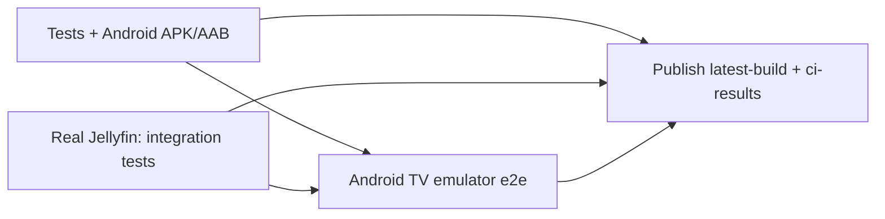

# Testing Guide

GitHub Actions (`.github/workflows/build.yml`) runs on every push (only `aurora-tv` publishes):

- **Unit tests** (`shared/src/commonTest`): fake Jellyfin via Ktor `MockEngine`. Covers API, sessions,
  profiles (incl. `LocalProfilesTest` for device-only profiles), playback decisions, skip detection
  (`CreditsVisionTest` for the on-screen outro check), fingerprints, recommendations (incl. the
  Charlotte case), the audio default (`AudioDefaultTest`), temporary files (`EpisodeTempFilesTest`),
  search, stores, updates, VPN address racing. They run on the JVM test host (`:shared:jvmTest`) and
  on Android (`:shared:testDebugUnitTest`).
- **JVM tests** (`jvmTest`): integration tests against a real Jellyfin in Docker (including intro +
  outro by listening on *Wavelength Street*, and the outro found on screen on *Harbor Precinct*, a
  generated live-action series whose credits music changes every episode and whose episode 2 has a
  post-credits scene), keyboard navigation UI tests, ratings UI test.
- **Emulator e2e** (`ci/android_e2e.sh`, `ci/android_release_smoke.sh`): sign-in, D-pad navigation
  with screenshots, playback/resume timings, Home fill time and request counts, and the
  "Layout and UI sounds" block (first-card position, headings, details hero, 3 moves = 3 ticks,
  OK = 1 chime, no sounds in the player, none when switched off).

Results and screenshots are pushed to the `ci-results` branch; builds to the `latest-build` release.

> [!warning] CI has no Fire TV and no GPU. Anything hardware-specific is listed in [[Known Issues]].

## Related notes
[[Build and Run]] · [[Change Log]]
