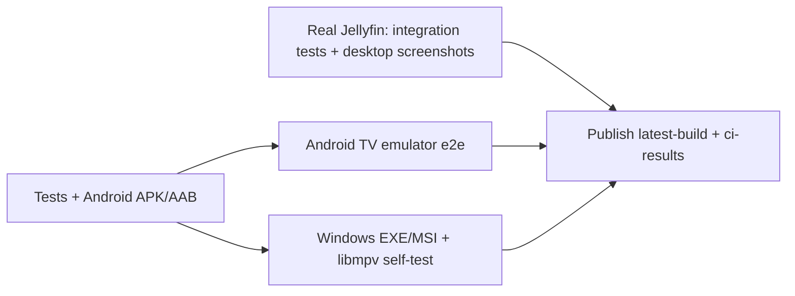

# Testing Guide

GitHub Actions (`.github/workflows/build.yml`) runs on every push to `aurora-tv`:

- **Unit tests** (`shared/src/commonTest`): fake Jellyfin via Ktor `MockEngine`. Covers API, sessions,
  profiles (incl. `LocalProfilesTest` for device-only profiles), playback decisions, skip detection,
  fingerprints, recommendations, search, stores, updates, VPN address racing.
- **Desktop tests** (`desktopTest`): integration tests against a real Jellyfin in Docker, keyboard
  navigation UI tests, ratings UI test.
- **Emulator e2e** (`ci/android_e2e.sh`, `ci/android_release_smoke.sh`): sign-in, D-pad navigation
  with screenshots, playback/resume timings, Home fill time and request counts, and the
  "Layout and UI sounds" block (first-card position, headings, details hero, 3 moves = 3 ticks,
  OK = 1 chime, no sounds in the player, none when switched off).
- **Windows**: packaged-app libmpv self-test (software decode on the runner), launch screenshot.

Results and screenshots are pushed to the `ci-results` branch; builds to the `latest-build` release.

> [!warning] CI has no Fire TV and no GPU. Anything hardware-specific is listed in [[Known Issues]].

## Related notes
[[Build and Run]] · [[Change Log]]
